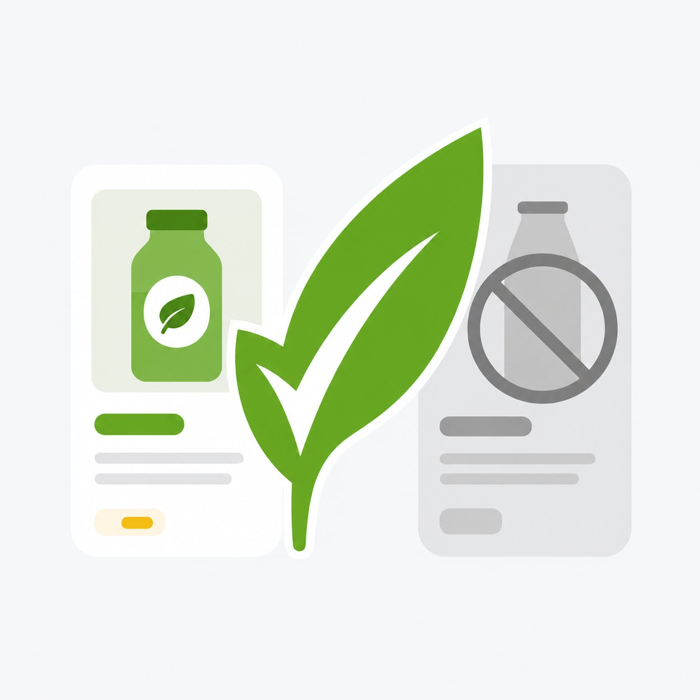
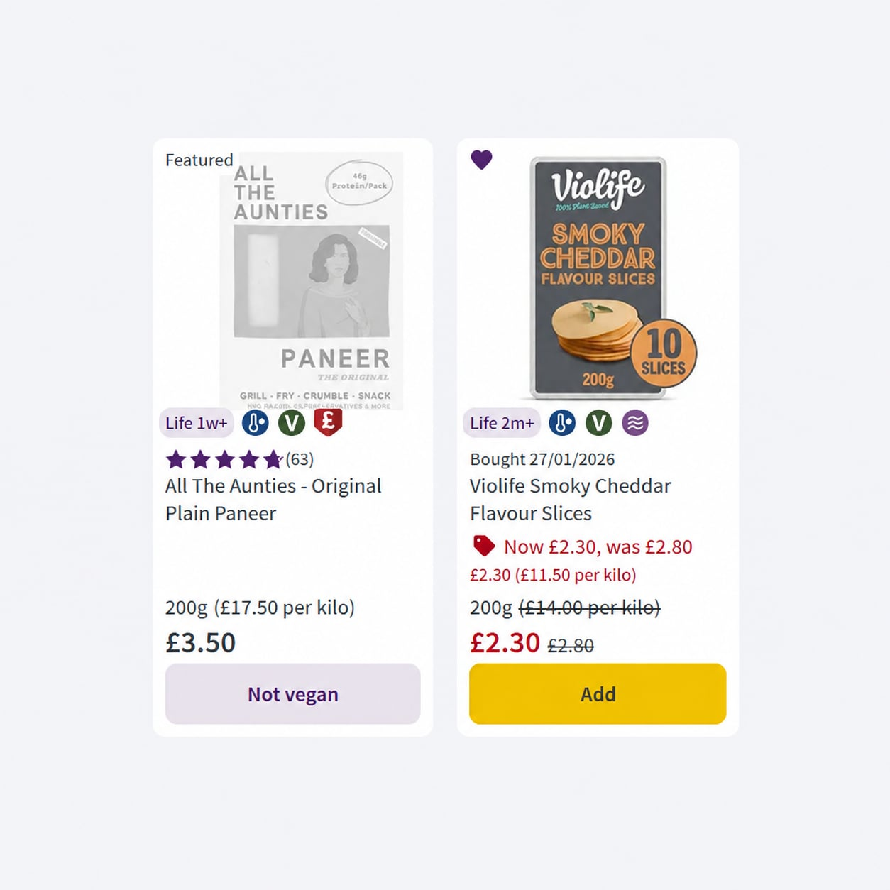

# Ocado Vegan Filter

Ocado Vegan Filter is a userscript that improves Ocado's incomplete vegan filtering on product grids, search results, category pages, and promotion pages.

Install it from Greasy Fork:

https://greasyfork.org/en/scripts/576838-ocado-vegan-filter

## What It Does

Ocado already has a vegan icon and filter, but some vegan products are missing from that metadata or do not show the vegan icon in product grids.

This script adds a client-side correction layer. It embeds over 19,000 vegan product IDs from an offline Ocado catalogue audit, including over 14,000 products beyond the officially tagged vegan set seen in the audit.

Products identified as vegan keep Ocado's normal styling and yellow `Add` button.

Known non-vegan products and products without enough evidence for a safe classification are visually muted:

- The product image is faded and desaturated.
- Promotional red text is muted.
- The `Add` button is restyled to look more like Ocado's grey out-of-stock controls.
- The button label shows `Not vegan` for an affirmative non-vegan classification or `Unknown vegan` when the evidence is inconclusive, and changes to `Add anyway` on hover.

The filter is cosmetic only. Product links still work, and the real Ocado `Add` button remains clickable.

## Screenshots

<p>
  
  
</p>

## How Products Are Classified

The offline classifier assesses the complete sold product, including relevant processing and supplied packaging/components. Supported positive evidence is an applicable Ocado vegan tag, scoped manufacturer confirmation, an affirmative whole-product vegan name or unambiguous ordinary vegan identity/composition. Manufacturer confirmation takes precedence over a name. Unresolved material doubts mean `unknown`; correctly matched definite animal ingredients or processing mean `nonvegan`, even when Ocado tags the product vegan.

While shopping, recorded nonvegan and blocked-unknown IDs take precedence over embedded positives and applicable live official tags. Names and URL slugs cannot promote a product at runtime. The script remains self-contained.

`Not vegan` means affirmative non-vegan evidence. `Unknown vegan` means the available evidence cannot establish suitability safely. The whole-product catalogue migration is being assessed on `dev`; existing embedded catalogue data is refreshed only after its validation gates pass.

## Data And Privacy

The userscript is self-contained while shopping. It does not fetch Ocado product detail pages in the background, and it does not call third-party services.

The large local SQLite database and raw scrape streams are intentionally not tracked in this repository.

## Repository Contents

- `ocado-vegan-filter.user.js`: local distributable userscript, with embedded IDs and generated counts.
- `tools/sync_ocado_database.py`: full discovery and detail refresh into SQLite.
- `tools/classify_ocado_vegan.py`, `tools/vegan_policy.py`, `tools/codex_evidence.py`: whole-product policy, deterministic decisions and two-pass Luna 6/high classification with disagreement-only Sol 6.1/medium arbitration.
- `tools/refresh_whole_product.py`: resumable all-known migration, source research, positive audit, transactional activation and export.
- `tools/research_ocado_manufacturers.py`: exhaustive source research, complete captures, applicability and outcome accounting.
- `tools/benchmark_whole_product.py`, `benchmarks/`: current frozen policy and browser fixtures.
- `tools/update_userscript_allowlists.py`: validated export with retained ID placement.
- `tools/build_ocado_database.py`: shared parsing/schema helpers and an isolated reconstruction command; never rebuild the live database with it.
- `docs/`: current working guide, classifier design, maintenance, manufacturer research and FireMonkey installation runbooks.
- `tests/`: current policy, persistence, sync, export and Firefox contracts.
- `audit/current-classifier/`: applicable validation reports.
- `assets/images/`: logo and shopping screenshot.

The source-of-truth SQLite database, snapshots, raw captures, call journals, virtual environments and resumable working data are intentionally ignored by Git. Older designs and reports are available in Git history.

## Development

The distributable userscript source is:

```text
ocado-vegan-filter.user.js
```

Read [AGENTS.md](AGENTS.md) and [the working guide](docs/working-guide.md) before maintenance. Use a virtual environment for the development dependencies:

```sh
python3 -m venv .venv
source .venv/bin/activate
python3 -m pip install -r requirements-dev.txt
```

Reuse the existing `.venv` when available. With it active, useful checks are:

```sh
node --check ocado-vegan-filter.user.js
python3 -m unittest discover -s tests
OCADO_LIVE_TESTS=1 python3 -m unittest discover -s tests -p test_ocado_vegan_filter.py
python3 tools/check_ocado_userscript_scenarios.py --output /tmp/ocado-responsive/checks.json
```

The normal suite includes real headless Firefox fixture tests and needs neither the local catalogue database nor a Codex login. Live Ocado checks are opt-in; CI and GitHub releases run the fixture suite without needing an Ocado account. Set `FIREFOX_BINARY` when Firefox is not on the default browser path. The real classifier safety benchmark is a separate command that calls authenticated Codex; the unit tests mock those model calls.

The scenario checker opens live milk, vegan-cheese, and offers pages in temporary Firefox at 390, 768, and 1440 CSS pixels, then checks initial and scrolled cards. It records the injected source hash, classification and appearance checks, visible link/button hit targets, and milk screenshots beside its JSON output. It leaves the installed userscript and basket alone; verify FireMonkey installation separately when testing an installed build.

For a catalogue refresh and userscript data update, follow [the monthly maintenance runbook](docs/monthly-maintenance.md).

Develop and test userscript and tooling changes on `dev`. Documentation-only commits may go directly to `main` between releases, provided its userscript remains identical to the latest release tag. Keep documentation about unreleased changes on `dev`. Before a release, merge any new documentation commits from `main` into `dev`; after local testing is approved, fast-forward merge `dev` into `main`, create the signed release tag there, and return to `dev`. Release versions describe the userscript, although Git tags snapshot the whole repository. Push only explicitly authorized branches and tags; release publication pushes `main` and the named tag atomically without force-pushing. See the [release procedure](docs/monthly-maintenance.md#7-commit-and-release) for the commands and publication checks.

## License

This project is released under the Unlicense. See [LICENSE](LICENSE).
